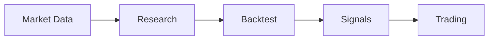

# TQX is all you need for AI trading.

**Research. Backtest. Trade.**

[Platform](https://www.tqx.ai) · [Data](https://docs.tqx.ai/data/info) · [Skills & CLI](https://github.com/tqx-ai/tqx-ts) · [Documentation](https://docs.tqx.ai)

 

## Build with TQX

<table align="center">
  <tr>
    <td align="center" width="50%">
      <strong>TypeScript SDK</strong> 
      Build research and trading workflows.  
      <code>bun add @tqx-ai/sdk</code> 
      or <code>pnpm add @tqx-ai/sdk</code>
    </td>
    <td align="center" width="50%">
      <strong>CLI</strong> 
      Run TQX from your terminal.  
      <code>bun add --global @tqx-ai/cli</code> 
      or <code>pnpm add --global @tqx-ai/cli</code>
    </td>
  </tr>
</table>
