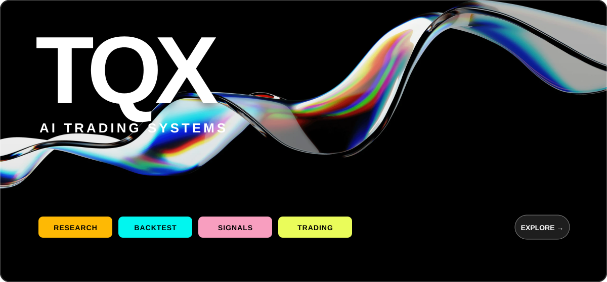
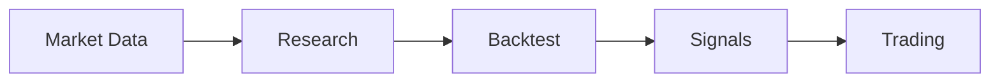

<div align="center">

<a href="https://github.com/tqx-ai/tqx-ts"></a>

# TQX is all you need for AI trading.

**Research. Backtest. Trade.**

[Platform](https://www.tqx.ai/) · [Skills & CLI](https://github.com/tqx-ai/tqx-ts) · [Documentation](https://docs.tqx.ai/) · [Data](https://docs.tqx.ai/data/info)

</div>

<br />

## Build with TQX



## Start with your favorite agent

Copy this prompt into Codex, Claude Code, Muse, Grok Bot, or any agent you use:

```text
Read https://raw.githubusercontent.com/tqx-ai/tqx-ts/refs/heads/main/skills/what-is-tqx/SKILL.md to install the latest tqx CLI and use it to check my account information and positions.
```
